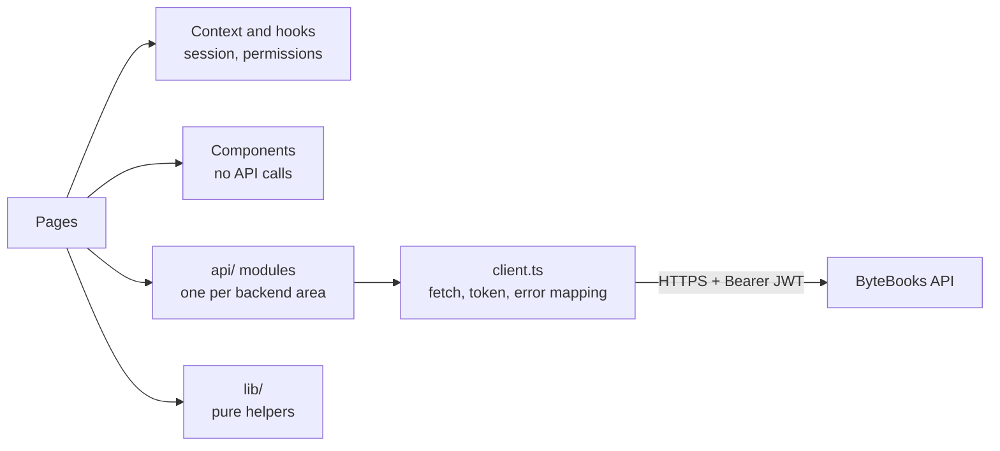

# ByteBooks

Web client for **ByteBooks**, a community book catalog: browse books by category, read and write reviews, save favorites and keep a public profile. Moderators edit the catalog and admins import titles from Google Books, all from the same interface.

**Live demo:** [bytebooks.lautaromoreyra.dev](https://bytebooks.lautaromoreyra.dev) · API: [bytebooks-api](https://github.com/lautaromoreyraa/bytebooks-api)


## Features

- **Catalog** with category filters, skeleton loading states and an in-memory cache, so going back from a book page doesn't reload everything.
- **Book page** with paginated reviews, average rating and star input; authors (and moderators) can delete reviews.
- **Accounts:** sign up, log in, edit profile and photo, manage favorites. Every user has a public profile with their saved books.
- **Role-aware UI:** edit, delete and import actions only appear for roles the API will actually accept, so nobody fills out a form just to get a `403`.
- **Google Books import** for admins: search, preview the candidates, pick categories and confirm.

## Tech stack

| Concern | Choice |
|---|---|
| UI | React 19, React Router 7 |
| Language | TypeScript 5.9 (strict) |
| Build | Vite 8 |
| Styling | Tailwind CSS 3 |
| Images | Cloudinary (profile photos and covers) |
| Tests | Vitest, Testing Library, jsdom |
| Hosting | Vercel, with Cloudflare Web Analytics (no cookies) |

## Architecture



- **Pages** own a route and orchestrate data loading; **components** are presentational and never call the API.
- **`api/client.ts`** is the single place that talks HTTP: base URL, the session token and translating API errors into messages the UI can show.
- **`lib/permisos.ts`** mirrors the backend authorization rules, and **`lib/cacheDeCatalogo.ts`** invalidates the catalog cache on every session change, because the catalog depends on who is looking (hidden books are only visible to staff).

## Project structure

```
src/
├── main.tsx · App.tsx   bootstrap, router and session provider
├── api/                 HTTP client + one module per API area (auth, libros, resenas, …)
├── pages/               one component per route
├── components/          reusable UI pieces (modals, cards, rating, skeletons)
├── context/             session state shared across pages
├── lib/                 pure helpers: permissions, cache, validation, Cloudinary, analytics
├── types/               API contract types
└── test/                mirrors src/, with shared fixtures
```

Routes: `/`, `/libros/:id`, `/login`, `/register`, `/favoritos`, `/usuarios/:id`, `/legal`.

## Getting started

**Prerequisites:** Node 20+ and the API running locally (see [bytebooks-api](https://github.com/lautaromoreyraa/bytebooks-api)).

```bash
npm install
npm run dev          # http://localhost:5173
```

| Variable | Purpose |
|---|---|
| `VITE_API_URL` | API base URL (defaults to `http://localhost:8080`) |
| `VITE_CLOUDINARY_CLOUD_NAME`, `VITE_CLOUDINARY_UPLOAD_PRESET` | Image uploads |

`VITE_*` variables end up in the browser bundle, so they only hold public values, never credentials.

### Quality checks

```bash
npm test             # Vitest: API layer, helpers, components and pages
npm run lint
npm run build        # type-check + production build
```

## Deployment

Vercel builds `main` on every push and serves the single-page app with a catch-all rewrite (`vercel.json`). Cloudflare manages the domain.
